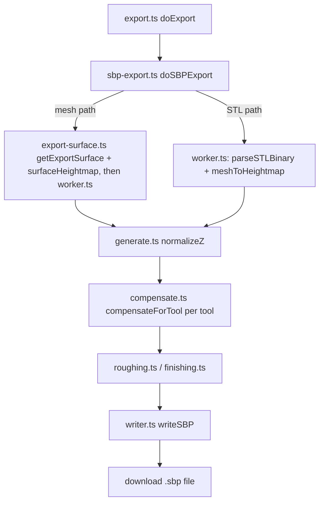

<!-- Captured from the Greptile knowledge base 2026-07-29. Greptile generated this from the
codebase and grounded its review findings in it; it is not hand-authored SOT.
Verify against live code before citing it as authoritative. -->

# SBP Export Pipeline

The app converts a generated heightfield mesh (or an uploaded STL) into ShopBot OpenSBP CNC toolpath code. `src/export.ts` dispatches to `src/sbp-export.ts`, which builds cutting config from UI state and always runs the pipeline in `src/sbp/worker.ts` (the current surface or relief master since 2026-10-19, or an uploaded STL), which chains `src/sbp/stl-parser.ts` -> `src/sbp/heightmap.ts` (STL only) -> `src/sbp/compensate.ts` -> `src/sbp/roughing.ts`/`src/sbp/finishing.ts` -> `src/sbp/writer.ts`.

## Mental model

## Entry points and dispatch

`src/export.ts`'s `_doExportInner` checks `STATE.exportFormat`; when it is `'sbp'` it calls `doSBPExport()` from `src/sbp-export.ts` and returns immediately (no shared post-processing with the other export formats). `doSBPExport` picks one of two source paths based on whether an STL was uploaded (`SBP_STATE.stlBuffer`):

- **Mesh path** (`exportFromMesh`): reads `getExportSurface(true)` (`src/export-surface.ts`): the full-resolution relief master when one is active (`activeMaster()`: an imported `.mcrelief` in DEPTH MAP, the drape relief in DRAPE), else the generated `STATE.vertices` grid. `surfaceHeightmap()` turns it into a `Heightmap` (copy, with row spacing and diagonal) and the job runs in `src/sbp/worker.ts`, like the STL path.
- **STL path** (`exportFromSTL`): posts the raw STL `ArrayBuffer`, the resolved `SbpConfig`, and a heightmap `resolution` (cells per inch) to the same worker, which parses and rasterizes it first. Both paths share `runSbpWorker`, which guards concurrent runs with `sbpWorkerRunning`, captures the job's filename and source when it starts (a result for a replaced model is downloaded under its own name and not attached to the current one), and hands a transferred `stlBuffer` back only if no newer upload replaced it.

Both paths converge on the same `generateSBP` function (`src/sbp/generate.ts`), so behavior is identical for a given heightmap regardless of source — the worker doesn't get a different pipeline.

## Config resolution

`buildConfig()` in `sbp-export.ts` starts from `getDefaultConfig(profile)` (`src/sbp/tools.ts`), then layers in UI state: enable flags, `stockTopIn()` (`src/state.ts`: the active relief master's stock, else `STATE.baseThickness`) as `materialZ`, offsets, safe/home Z, leave-stock, raster angle, and per-parameter overrides (feed rate, plunge rate, RPM, stepdown, stepover) the user dragged from the profile default. `src/sbp/tools.ts` embeds a fixed ATC tool table (`EMBEDDED_TOOLS`) with geometry (type, diameter, tip radius, half-angle) and per-`MaterialProfile` (`general`/`mdf`/`hardwood`) cutting params sourced from Vectric `.vtdb` exports; `resolveCutting` falls back to `general` then the first available profile. Default roughing tool is the "Chipbreaker" end mill; default finishing tool is "TBN R1/16-S1/4" (tapered ball nose).

## Stage 1: getting a heightmap

A `Heightmap` (`src/sbp/types.ts`) is a regular `Float64Array` Z-grid plus `rows`/`cols`/`cellSize`/`cellSizeY`/`meshX`/`meshY` and an optional cell `diagonal`. Producers:

- `surfaceHeightmap` (`src/export-surface.ts`): copies an `ExportSurface` (the relief master or the generated grid) into a `Heightmap` with `cellSize = meshX / (cols - 1)`, `cellSizeY = meshY / (rows - 1)` and the surface's diagonal. `stateToHeightmap` (`src/sbp/heightmap.ts`) does the same for a `number[][]` grid and is now used by the specs only.
- `meshToHeightmap` (`src/sbp/heightmap.ts`), fed by `parseSTLBinary` (`src/sbp/stl-parser.ts`) — parses a binary STL into a `Float32Array` (12 floats/triangle: normal + 3 vertices) with bounds tracked in the same pass. `meshToHeightmap` then rasterizes: for each triangle, it walks its XY bounding box in grid cells and barycentrically interpolates Z, keeping the max Z per cell (top-surface wins on overlap). A gap-fill pass expands a nearest-neighbor ring (up to 5 cells) for any cell no triangle touched, falling back to the STL's global minimum Z if nothing is found within that radius.

## Stage 2: Z normalization

`generateSBP` (`src/sbp/generate.ts`) first calls internal `normalizeZ`, which shifts the entire grid up if any Z value is negative (so all cutting is above the table), and bumps `config.materialZ` up if it doesn't already clear the surface's max Z plus a small margin. This guarantees stock thickness is never thinner than the tallest point on the part, which the finishing stage's boundary traverse (see below) depends on.

## Stage 3: tool compensation

`compensateForTool` (`src/sbp/compensate.ts`) computes, at every node, the lowest tip height that clears the surface everywhere under the cutter: `tip(x) = max over d of (H(x + d) - profile(|d|))`, exact over the grid with a true radial kernel and physical X/Y spacing. Before 2026-10-19 it took the MINIMUM with a separable 1D kernel, which put the tip below the surface (a flat 0.500 in plane came out at 0.4732 in under a 0.1 in ball; an end mill erased a 0.5 in peak), and it modelled the tapered ball nose's side angle as measured from the horizontal, so the 3.58 deg TBN was cut as a nearly flat 1/8 in disc. `toolZOffset` now takes side angles from the tool axis (ball tangent to the cone at r = R cos a, slope 1/tan a beyond) and throws on an unmodelled `ToolType`. Roughing uses it with `segment = cellSize` and `slack = cell diagonal`, so a node-to-node move held at its higher end stays clear of the triangulated surface between nodes. Finishing does not interpolate node tips at all: `createDropCutter` evaluates the exact tip at every emitted point against the exported triangles (vertex, edge and facet contact), and each straight move is certified: the exact tip is sampled at the n - 1 interior points that cut the move into n equal intervals (n from 2, doubling to 256), and the move is accepted only if every sample excess is within 0.0001 in and the largest plus L h / 2 (h = |ab| / n) is within 0.0004 in, with L a local bound on the tip's slope (`createTipLipschitzField`); otherwise it is split, and at the deepest split the cutter lifts and crosses at max(ends) + L |ab| / 2. Flat end mills and radius-0 radiused cutters are refused for finishing. A node-only drop-cutter gouged 0.089 in between nodes on 0.09 in cells. `cli/sbp-cut.spec.ts` replays the emitted SBP through an independent swept-cutter simulation (`cli/cut-sim.ts`) to check all of this.

## Stage 4: toolpath generation

- `generateRoughing` (`src/sbp/roughing.ts`) computes discrete Z levels from `materialZ` down to a fixed 0.050" floor, stepping by the roughing tool's `stepdown`. At each level it serpentine-rasters (alternating sweep direction) at `stepover`-cell intervals, cutting `max(zLevel, surfaceZ + leaveStock)` so it never removes the reserved finishing allowance — retracting to `safeZ` between disconnected cut segments.
- `generateFinishing` (`src/sbp/finishing.ts`) instead produces one continuous toolpath: `computeRasterLines` computes parallel lines across the workpiece at `finishRasterAngle` degrees (default 45), and each line is sampled at a uniform 0.005" spacing with Z from `createDropCutter` on the target surface, plus extra points (and, at the deepest split, lift-and-cross holds) wherever a move cannot be certified as above (no point-reduction, for consistent surface finish). Between lines, the tool traverses at `materialZ` rather than retracting to `safeZ`. This is only safe because Stage 2 guaranteed `materialZ` clears the surface; `generateFinishing` throws if a line endpoint's Z would exceed `materialZ` at traverse time, catching a `normalizeZ` regression early.

`generateSBP` runs whichever of roughing/finishing are enabled (independently toggleable) and collects their `ToolpathSection`s.

## Stage 5: writing OpenSBP

`writeSBP` (`src/sbp/writer.ts`) serializes header comments (material extents, home/safe Z), then per-section tool-change (`C9`), spindle-on (`C6`/`TR`), and feed-rate (`MS`) commands, followed by move lines: `J3` for rapids, `M3` for cuts, 6 decimal places. It inserts an intermediate retract-to-`safeZ` `J3` when transitioning from a cut back to a rapid, and a final home move (`J3` then `JZ` to `homeZ`) at the very end. The format is stated as verified line-by-line against Aspire reference output — any layout change here should be diffed against a known-good reference file, not just visually inspected.

## Change checklist

When these files or sections are changed, remember to consider these:

- If `SbpConfig` or `ToolDef`/`CuttingParams` in `src/sbp/types.ts` change shape, update all three producers of `SbpConfig` (`getDefaultConfig` in `src/sbp/tools.ts`, `buildConfig` in `src/sbp-export.ts`) and the worker's `WorkerInput`/message contract in `src/sbp/worker.ts`, which structurally clones the config across the postMessage boundary with no schema validation.
- If `ToolType` gains a new variant or geometry parameter, `toolZOffset` in `src/sbp/compensate.ts` and `cutterProfile` in `cli/cut-sim.ts` must both add a branch. An unhandled type throws in both (it used to fall silently into a flat end mill).
- If the roughing floor (0.050", `src/sbp/roughing.ts`) or the finishing traverse height contract (`materialZ` must clear all surface points, enforced by `normalizeZ` in `src/sbp/generate.ts`) changes, re-verify `generateFinishing`'s boundary-traverse assumption in `src/sbp/finishing.ts` — it throws instead of silently gouging, so a `normalizeZ` change that stops guaranteeing headroom will surface as a hard export failure, not corrupted G-code.
- If `src/sbp/writer.ts`'s move/command format changes, re-diff full sample output against the Aspire reference; the format comment states it was verified line-by-line and downstream ShopBot controllers parse it literally.
- The Voronoi-relief stepover warning in `src/sbp-export.ts` (`buildReliefStepoverWarning`) hardcodes a physical seam-width derivation tied to `voronoi-relief.ts`'s seam smoothstep gate; if that noise algorithm's seam geometry changes, this warning's math goes stale silently (it will just produce a wrong recommended stepover, not an error).

## Important failure modes

| Trigger | Consequence | Guard |
|---|---|---|
| STL with degenerate XY bounds (zero width/height) | `meshToHeightmap` throws `Degenerate STL bounds` | `src/sbp/heightmap.ts` bounds check before rasterizing |
| STL buffer truncated or corrupted | `parseSTLBinary` throws on size mismatch or zero-triangle count | `src/sbp/stl-parser.ts` validates header + expected byte length up front |
| Large gaps (>5 cells) in triangle coverage after rasterization | Gap cells fall back to global STL min Z, potentially cutting far too shallow/deep in that region | `MAX_GAP_RADIUS` ring search in `src/sbp/heightmap.ts`, silently falls through rather than erroring |
| A DRAPE carve change (size, Material Thickness, Relief Depth) is still being remapped when the user exports | size or stock top from one carve, heights from another | `getExportSurface` refuses while `drapeCarvePending()` (`src/export-surface.ts`); `.mcrelief` download does too; `npm run test:drape` D14 |
| `materialZ` drops below the compensated surface between normalization and finishing traverse | `generateFinishing` throws `Finishing traverse requires materialZ to be above the surface` | explicit check in `src/sbp/finishing.ts` before emitting boundary-traverse moves |
| Second STL export triggered while worker still running | Blocked with a toast, no queued retry | `sbpWorkerRunning` flag in `src/sbp-export.ts` |
| Worker throws during parse/generate (e.g. bad STL) | `postMessage` returns an `{type:'error'}` payload; STL buffer is returned so UI doesn't lose the upload | try/catch in `src/sbp/worker.ts`'s `onmessage` |

## Key files

| File | Why to read it |
|---|---|
| `src/export.ts` | Top-level export dispatcher; routes `fmt === 'sbp'` to `doSBPExport` and returns early, bypassing other export formats' shared logic |
| `src/sbp-export.ts` | UI wiring, config assembly (`buildConfig`), source selection (mesh vs. STL), worker invocation, download + toast handling |
| `src/sbp/types.ts` | Canonical shapes: `SbpConfig`, `ToolDef`, `Heightmap`, `ToolpathMove`/`Section`, `SbpStats` |
| `src/sbp/tools.ts` | Embedded ATC tool table and per-material cutting params; default tool/config resolution |
| `src/sbp/stl-parser.ts` | Binary STL -> flat `Float32Array` + bounds, single-pass, validated |
| `src/sbp/heightmap.ts` | STL rasterization (`meshToHeightmap`) and the spec-only grid reshape (`stateToHeightmap`); the app's mesh path uses `surfaceHeightmap` in `src/export-surface.ts` |
| `src/sbp/generate.ts` | Pipeline orchestrator (`generateSBP`), Z normalization |
| `src/sbp/compensate.ts` | Exact max-envelope tool compensation (2D radial kernel) and the finishing drop-cutter, per `ToolType` geometry |
| `src/sbp/roughing.ts` | Z-level serpentine raster roughing toolpath |
| `src/sbp/finishing.ts` | Continuous angled-raster finishing toolpath with boundary traverses |
| `src/sbp/writer.ts` | OpenSBP text serialization (header, tool changes, moves, footer) |
| `src/sbp/worker.ts` | Web Worker entry: STL parse -> heightmap -> `generateSBP`, transferable-buffer messaging |
