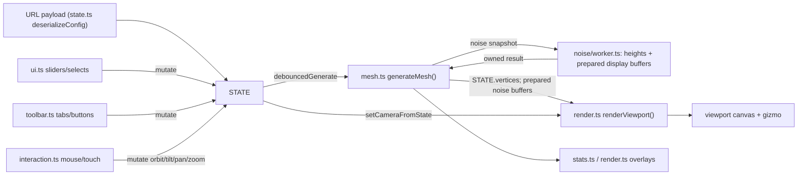

<!-- Captured from the Greptile knowledge base 2026-07-29. Greptile generated this from the
codebase and grounded its review findings in it; it is not hand-authored SOT.
Verify against live code before citing it as authoritative. -->

# UI and State

MESHCRAFT is a single-page app built around one global mutable object, `STATE` (`src/state.ts`), that every other module reads and writes directly — there is no reactive framework or dispatch layer. The sidebar (`src/ui.ts`), toolbar (`src/toolbar.ts`), viewport interaction (`src/interaction.ts`) and renderer (`src/render.ts`) all mutate `STATE` in place and then call `generateMesh()`/`debouncedGenerate()` or `renderViewport()`/`requestRender()` to propagate the change. `src/main.ts` is the sole entrypoint, wiring DOM structure from `index.html` to these modules on `DOMContentLoaded`.

## Mental model

## State shape and lifecycle

`MeshState` (`src/state.ts`) is one flat interface holding every dial in the app: noise parameters, voronoi-relief parameters, mesh dimensions, depth-map settings, camera/view transform, export options, and internal generation results (`vertices`, `cols`, `rows`, `genTime`, `sbpStats`). `STATE` is a live singleton (`export const STATE: MeshState = { ...DEFAULTS }`), and `DEFAULTS` is the reset target used by double-click-to-reset (`slider-utils.ts`) and the "Reset View" button (`toolbar.ts`). There is no separate "commit" step — assigning to `STATE.foo` is itself the state update.

A parallel path lets state travel in a URL: `serializeConfig()` diffs `STATE` against `DEFAULTS` over a curated `URL_SERIALIZABLE_KEYS` allowlist, base64url-encodes the diff, and tags it with a payload version (`CURRENT_PAYLOAD_VERSION`). `deserializeConfig()` (invoked once, in `main.ts`'s `init()`) reverses this, accepting the current payload version only. Older versions return no settings and set a reset notice, which `main.ts` consumes to show "This link was made with an older MeshCraft. Settings were reset." Legacy default backfills were removed. `findEncodedPayload()` tolerantly extracts the payload from query string, hash, or even a malformed path (an iOS clipboard failure mode). Every numeric URL field must be an actual finite JSON number; strings, booleans, null, arrays and objects fall back to defaults. Numeric fields that could cause pathological O(rows·cols·sites) relief computation (`reliefRelaxIterations`, `reliefDensityStrength`, etc.) are clamped after decode since URL payloads are untrusted input, unlike slider-driven values which are already range-limited by the DOM.

`noiseDims` is a small side-cache (not part of `MeshState`) that preserves NOISE's board across mode switches: `meshX`, `meshY`, `resolution` and `baseThickness`, which DEPTH MAP (`fitMeshToAspect()`, a loaded `.mcrelief`'s stock) overwrites. `saveNoiseDims()` is its only writer and `restoreNoiseDims()` its main reader (the tab switch and the `.mcrelief` load both use them); `ensureDrapeFigure` in `drape-ui.ts` also reads it for a page opened on DRAPE.

## Sidebar construction and control wiring

`buildSidebar()` in `src/ui.ts` is the single function that reconstructs the controls pane from current `STATE` and leaves the Sponsors pane DOM intact; it is called on init, on noise-type change, on preset/profile selection, on depth-map load, and on mode switch: anywhere the set of *visible* controls must change (e.g. relief mode shows `buildReliefSections()` instead of `buildPeakValleySection()`/`buildAdvancedNoiseSection()`; DRAPE mode shows `buildDrapeSections()`: figure upload and placement, presets, Generate/Cancel/Download, then Figure, Cloth, Attraction, Face (local attraction, surface fit), Wind / Pressure, Solver and Carve sections built from the `DRAPE_CONTROLS` table in `src/drape-controls.ts`, wired to `src/drape-ui.ts`; pose controls rebuild the bare figure, carve controls remap the relief, the rest wait for Generate). `runDepthEstimation()` in `ui.ts` drives the "Estimate Depth" button, calling `estimateDepth()` (`src/depth-estimate.ts`) to replace `STATE.depthMap` with an AI-inferred depth image; see `mesh-generation-core` for the model/timeout details. Each control is built declaratively via `slider()` or `enumSelect()` helpers that read the current `STATE[key]` value and stamp a `data-key` attribute; `wireControls()` then does one generic query (`input[type=range][data-key]`, `select[data-key]`) to attach `input`/`change` listeners rather than each section wiring itself. This generic-wiring pattern means any new slider or select just needs the `data-key` attribute, no per-control listener code.

Slider input handlers do several side effects beyond `STATE[key] = v`: they resync the value badge, cascade aspect-locked mesh dimensions (`meshX`/`meshY` cross-update when `STATE.aspectLocked`; on the Drape tab both set `STATE.drapeCarveWidth` instead, on a 3:4 grid, and remap the relief), clamp only the active non-master mode's cut-depth request to the smaller of `STATE.baseThickness` and `MAX_CUT_DEPTH_IN`, preserving the other mode's saved request, resync the SBP safe-Z (`syncSbpSafeZ()`, from `sbp-export.ts`; the Drape tab's Material Thickness waits for the remapped master instead, and sidebar rebuilds and new drape results use `syncSbpSafeZIfStockMoved()`, so a raised Safe Z survives when the stock top has not moved), and clear `activePreset`/`activeProfile` on manual edits before calling `debouncedGenerate(key)` (from `src/mesh.ts`, debounced regeneration keyed by which field changed).

Stock thickness is capped at `MAX_STOCK_THICKNESS_IN`, and board dimensions at the machine bed. `presetState()` resets preset-owned generation fields from defaults before applying a selected preset; seed, resolution, camera, mode and export settings stay with the user.

`src/slider-utils.ts` provides `attachValueEdit()`, wired onto each `.val` label in `ui.ts`, letting users click a value to type an exact number; it preserves exact continuous values, normalizes explicitly declared count domains and clamps to `min`/`max` before dispatching a synthetic `input` event, funneling back through the same slider handler above.

Range construction and every programmatic range update use `configureRange`/`syncRange` in `src/slider-utils.ts`. The shared binding retains the nominal increment, exact model value and value label; input handlers read `readRangeValue`. The native thumb string can lose IEEE-754 digits even with `step=any`, so synchronized/editor writes retain the exact model value independently of that position string. Browser tests bound this native serialization error explicitly and compare the exact controller/label against actual serialized STATE. A detached native range checks whether the current value, effective reset value and maximum fit the nominal grid; the live range uses `step=any` when needed to preserve them exactly. Keyboard arrows retain the nominal increment. `src/numeric-domain.ts` declares semantic counts independently of that increment; configure/sync/read and URL imports share integer-floor or nearest-even-cloth normalization. Exact continuous edits still obey physical bounds. Drape master updates, depth caps, aspect fitting, SBP defaults/bounds/overrides, camera gestures and Fit all use that synchronization path. Safe/Home use continuous gap bounds; an IEEE guard removes arithmetic noise only from derived short-decimal endpoints, independently of stock-rounded reset defaults. Stock changes first commit a legal Safe/Home model pair under that gap, preserving a valid user Home or using the stock-derived target when needed. Editable Drape aliases read drapeCarveWidth/drapeStock request fields even while a remap is pending. meshX/Y follow the completed master, while baseThickness follows the requested stock immediately. Exports read the completed master and stockTopIn(), and refuse a pending remap. Reset visibility compares the exact canonical value with the effective bounded default rather than hiding native-step rounding. `controlIsReadOnly(key)` in state.ts locks only imported DEPTH MAP source fields, and both construction and input guards use that policy. Live Drape dimensions/stock remap its generated master and remain editable across sidebar rebuilds. Read-only imported master controls include actual source values in their presentation bounds, including values below ordinary editable minima; import limits and edit guards still own the source. A small master can set the preview density below the usual initial minimum.

## Toolbar, tabs, and export controls

`src/toolbar.ts` owns mode tabs (noise/depthmap/drape), view-mode buttons (solid/wireframe/both/points), export-format buttons, and action buttons for Regenerate, Random Seed, Fit, Reset View, Copy Link and Export. `setupTabs()` handles the mode-tab logic including the noiseDims save/restore dance and auto-applying the demo depth map (`demoDepthMap` from `state.ts`, preloaded by `main.ts`'s `preloadDemoDepthMap()`) when switching into depthmap/drape mode with no user image loaded. `updateExportControls()` toggles mesh-only checkboxes vs. the SBP sidebar section based on `STATE.exportFormat === 'sbp'`. The Copy Link handler (`setupToolbar()`) calls `serializeConfig()` and builds a clean URL via `URL`/`searchParams` rather than string concatenation, explicitly resetting `pathname` to `/` to strip any inherited iOS path-payload.

At widths through 900 px, `src/mobile-layout.ts` places persistent Shape, mode-aware Generator, View, Export and Sponsors panels below the stage. The 44 px header contains generation modes and the viewport-action overflow. The handle alone drags the controls between peek, half and full heights; arrow keys and Home/End operate the handle, and task tabs use roving tabindex with linked ARIA panels. Peek is 120 px plus the bottom safe-area inset. Export selects full height so its primary action is visible. Desktop retains the full sidebar and export bar. Breakpoint changes move the existing export nodes, preserving their listeners and current values. Pane scroll/focus uses separate mobile task keys, including Sponsors, in `sidebar-state.ts`; section IDs still own accordion history. Its shared `showSidebarPane()` transaction captures the outgoing view, prepares and presents the destination task, then restores scroll and focus. The existing Sponsors, Back and mode listeners all use this ordering. Section and role decisions use the applied layout variant, including rebuilds while a media-query change is waiting. The media-query listener captures the outgoing view while its body data flag still holds the old CSS geometry, then switches the flag and restores the destination snapshot. Resize callbacks wait for that switch, so CSS cannot clamp the outgoing snapshot first. Content changes still clamp to the current valid scroll range. Sidebar scroll anchoring is disabled because the explicit snapshots own restoration.

Layout observes the canvas, sidebar, main container and visual viewport. Safe areas and software-keyboard occlusion change the measured stage without rewriting camera STATE. Renderer initialization captures a portrait distance scale from its initial height-to-width ratio when that ratio exceeds one. The scale stays fixed, so snaps and resizing preserve physical camera distance as well as camera STATE. Explicit Fit uses `fitVisibleSource()` in `render.ts` and the perspective inequalities in `fit-frame.ts`, reserving measured overlay bands and the axis inset. It retains orientation, fits the source bounds, then updates zoom/pan. Fit from a full sheet first reveals the scene. Zero or insufficient available height refuses a fit without producing invalid projection values.

Relief controls are grouped into Cells, Walls & Floors, Layout and Base. `syncReliefControls()` hides dependencies while preserving their values. Density Boost and Cell Size Gradient remain active with Mode None; anchor axes/radius follow the selected attractor, and mask-shaping controls hide only when the mask is constant. Domed Floors is a numeric 0/1 checkbox with the shared visible-reset path. Base waves, pillow coverage, anisotropy angle and radial controls follow their actual enabling values. These presentation changes do not alter sampler defaults. Compact mobile stats hide only marked secondary metrics. The generated capped-site notice remains a visible diagnostic row.

## Viewport interaction and rendering

`src/interaction.ts` binds mouse and touch listeners on `#canvasWrap` to drive `STATE.orbit`, `STATE.tilt`, `STATE.panX/panY`, and `STATE.zoom` directly — left-drag orbits, right/shift-drag or two-finger-drag pans, wheel/pinch zooms, double-click calls `zoomExtents()` (`src/stats.ts`). It throttles camera updates via `requestAnimationFrame` (`queueRender()`) rather than re-rendering per mousemove event, and keeps sliders visually in sync (`syncSlider()`) since orbit/tilt/zoom are also slider-editable in `ui.ts`.

`src/render.ts` owns the actual three.js scene: `ensureRenderer()` lazily creates the renderer/scene/camera/gizmo on first use; `renderViewport()` replaces surface/enclosure geometry when `STATE.vertices` (identity-compared) or dimensions change, creates wireframe/points lazily, then calls `setCameraFromState()` to position the camera from `STATE.orbit/tilt/roll/zoom/panX/panY` and schedules a render via `requestRender()`'s on-demand rAF pattern (no permanent render loop — it renders only when `_needsRender` is set). Surface color comes from `makeSurfaceMaterial()`: with `STATE.viewMaterial === 'elevation'` (default) a precomputed height-ramp `DataTexture` (`getColorRampTexture()`) sampled by per-vertex UV rather than vertex colors, avoiding banding; with `'neutral'` a single warm-white Phong color, so shading alone shows the form (the ramp's iso-height bands read as contour lines). The View Controls shading select calls `applySurfaceMaterial()`, which swaps and disposes the material without regenerating geometry; the cached ramp texture is kept. `buildSurface()` attaches prepared attributes and bounds to Three.js geometry. For noise, `src/noise/worker.ts` calls the shared `buildSurfaceBuffers()` in `src/render-geometry.ts` to prepare full-density Float32 positions, analytical central-difference normals and UVs, Uint32 triangle indices, an exact Float32 bounding box and a conservative bounding sphere. These buffers transfer with the owning request's Float64 heights; the prepared bounds avoid first-draw vertex scans. Non-noise previews and noise Worker-constructor fallback call the same builder inline, retaining a relief master's fixed diagonal.

Wire buffers are prepared in the noise worker only when Wireframe or Both is requested. View-only first use otherwise runs `src/render-wire-worker.ts`, owned by the current source and mode and retired on surface replacement; blocked construction or worker failure retains the inline wire builder. Points remain lazy. Display Float32 buffers never become an export source: `getExportSurface()` reads the authoritative full-resolution Float64 heights, with noise revision guards and relief-master ownership unchanged.

`src/stats.ts` (`updateStats()`, `zoomExtents()`) and the dims/warning overlay in `render.ts` (`updateDimsOverlay()`) read `STATE.vertices`/`cols`/`rows`/`genTime`/`sbpStats` to render the on-canvas HUD; both are called after mesh generation and after view-mode or export-format changes.

`src/toast.ts` is a minimal transient-message singleton (`showToast()`) used by the Copy Link flow (`toolbar.ts`) for clipboard success/failure feedback. `src/sponsor.ts` opens an explicit Sponsors pane with ShopBot and Bits&Bits links. Mobile file actions live in Export; the scroll-to-export button is removed. No timer or session-storage flag opens sponsor content. `src/sidebar-state.ts` preserves pane scroll/focus and section open state across control rebuilds. Delegated in-pane focus/input tracking remembers the last control/editor before header navigation; explicit Back restores it. Enter and Escape clear the completed draft while retaining its range control identity. Navigation blur may restore a valid committed editor, but rejected or clamped text cannot return. Programmatic rebuilds retain active unfinished drafts, including transitional invalid input. Mobile initialization closes unseen hidden sections and permits at most one visible open section. Accordion actions close visible siblings while retaining other modes' saved choices. Section IDs own the state, with a separate initialization flag so deliberately closing every section survives a rebuild. Mode changes return to controls without making Sponsors a generation mode.

## Entrypoint wiring

`src/main.ts`'s `init()` runs once on `DOMContentLoaded`: it applies any URL-encoded config into `STATE`, syncs toolbar button active-classes to the (possibly URL-overridden) `STATE`, then calls `buildSidebar()`, `setupTabs()`, `setupToolbar()`, `updateExportControls()`, `setupInteraction()`, `setupResize()`, `setupSponsors()`, `setupMobileLayout()`, and finally `generateMesh()` (from `src/mesh.ts`) to produce the first mesh. `preloadDemoDepthMap()` runs after, asynchronously fetching a demo image so depth-map/drape mode has a placeholder without requiring a user upload.

## Change checklist

When these files or sections are changed, remember to consider these:

- Adding a new `MeshState` field in `src/state.ts`: decide whether it belongs in `URL_SERIALIZABLE_KEYS` and `PRESET_OWNED_KEYS`. Bump `CURRENT_PAYLOAD_VERSION` when generation semantics change; incompatible older links reset visibly rather than migrating.
- Adding a string-enum field to `URL_SERIALIZABLE_KEYS`: add it to `ENUM_VALUES` (typed `Record<Union, true>`, so the typecheck fails if the table and the union drift) and a `clampEnum()` call in `deserializeConfig()`.
- Adding a slider/select in `src/ui.ts`: use the `slider()`/`enumSelect()` helpers with a `data-key` matching the `MeshState` field name — `wireControls()`'s generic query-based wiring depends on this attribute, not on manual per-control listeners.
- Adding a numeric field that participates in relief/noise cost scaling: add an explicit clamp in `deserializeConfig()` (`src/state.ts`) mirroring the slider's min/max, since URL payloads bypass the DOM's built-in range clamping and can otherwise trigger runaway computation.
- Changing `STATE.baseThickness` semantics: `wireControls()` in `ui.ts` and `syncSbpSafeZ()` (sbp-export.ts, out of scope here) both derive dependent slider maxes from it — verify both stay consistent.
- Changing camera fields (`orbit`, `tilt`, `roll`, `zoom`, `panX`, `panY`): both `interaction.ts` (drag/wheel/touch) and `ui.ts`'s View Controls sliders write the same fields — keep clamp ranges (e.g. zoom 0.1–10, tilt -90–90) identical in both places or the UI and mouse input will disagree.
- Changing `noiseDims` or the mode-switch logic in `toolbar.ts`'s `setupTabs()`: this saves/restores noise-mode dimensions across a depthmap excursion, and `src/drape-ui.ts` (`ensureDrapeFigure` / `restoreSizeAfterDrape`) saves and restores every tab's size controls and camera around a DRAPE visit (DRAPE points the camera straight at the carve); a missed branch silently loses the user's mesh size or stock.

## Important failure modes

| Trigger | Consequence | Guard |
|---|---|---|
| Crafted/edited URL payload sets `reliefRelaxIterations` or `reliefDensityStrength` very high | Relief generation becomes O(rows·cols·sites) and can hang the browser tab | `deserializeConfig()` clamps these fields explicitly (`src/state.ts`) |
| `STATE.vertices` array is mutated in place rather than replaced | `renderViewport()`'s identity check (`STATE.vertices !== _lastVerticesRef`) misses the change and the old geometry keeps rendering | Mesh generation must always assign a new array/object to `STATE.vertices` |
| New slider/select added without a `data-key` attribute | `wireControls()`'s generic selector never finds it, so the control renders but does nothing | Follow the `slider()`/`enumSelect()` pattern in `ui.ts` |
| URL payload sets a string enum to a non-string (`["blend"]`, `{}`, `null`) or an unknown name | An array that stringifies to a valid name passed a `String()`-coerced check, then failed every strict `===` downstream; an unknown `mode` hides every sidebar section | `clampEnum()` requires `typeof === 'string'` and membership in `ENUM_VALUES` / `CNC_PRESETS` / `PROFILES` for all 11 string-enum keys (`npm run test:drape` T15) |
| Generation semantics change without a payload-version bump | Old links silently render a different shape | Bump `CURRENT_PAYLOAD_VERSION`; older payloads reset with a toast |

## Key files

| File | Why to read it |
|---|---|
| `src/state.ts` | `MeshState` shape, `DEFAULTS`, URL share-link encode/decode and incompatible-version reset |
| `src/ui.ts` | Sidebar section builders, generic slider/select wiring, preset/profile/depth-map upload handlers |
| `src/toolbar.ts` | Mode tabs, view/export-format buttons, Copy Link, resize hookup |
| `src/mobile-layout.ts`, `src/fit-frame.ts` | Persistent phone task panels, handle snaps, measured layout and perspective fit inequalities |
| `src/interaction.ts` | Mouse/touch orbit/pan/zoom drag handling, rAF-throttled camera updates |
| `src/render.ts` | Three.js scene, prepared-buffer attachment, lazy overlays, enclosure geometry and render scheduling |
| `src/render-geometry.ts`, `src/render-wire-worker.ts` | Shared exact display-buffer/bounds arithmetic and cancellable view-only lazy wire preparation |
| `src/slider-utils.ts` | Click-to-edit value label behavior shared by all sliders |
| `src/stats.ts` | Zoom-extents camera fit, HUD stat overlay (triangle/vertex counts, SBP stats) |
| `src/toast.ts` | Transient toast message singleton |
| `src/sponsor.ts`, `src/sidebar-state.ts` | Explicit Sponsors pane and persistent sidebar presentation state |
| `src/main.ts` | Single entrypoint: URL state apply, module wiring order, initial `generateMesh()` |
| `index.html` | DOM structure and element IDs that every module above queries by ID |

Noise slider input starts a leading preview immediately, including input faster than a frame. One running same-gesture request coalesces newer settings; its result is a labeled display approximation, never an export source. Release/change and bounded numeric-input completion request the full resolution. View-only input leaves generation scheduling intact. `captureExportSource()` in `export-surface.ts` validates source identity/settings at asynchronous preparation and delivery boundaries; `downloadCurrentSource()` shares the final encoder-delivery guard. SBP captures its source, filename and config before preparation, then preserves the existing identified-job delivery behavior after worker handoff.
