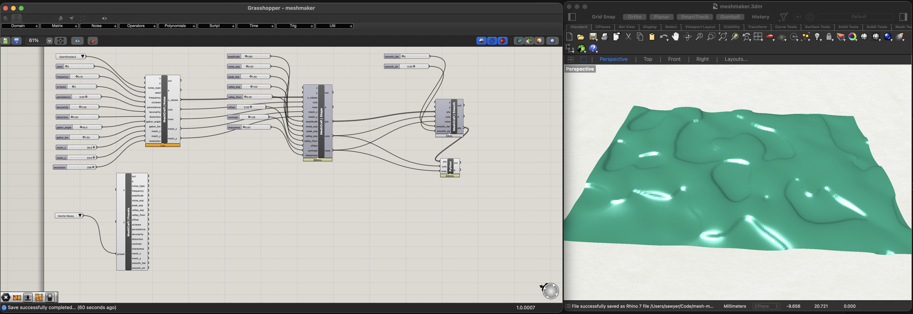
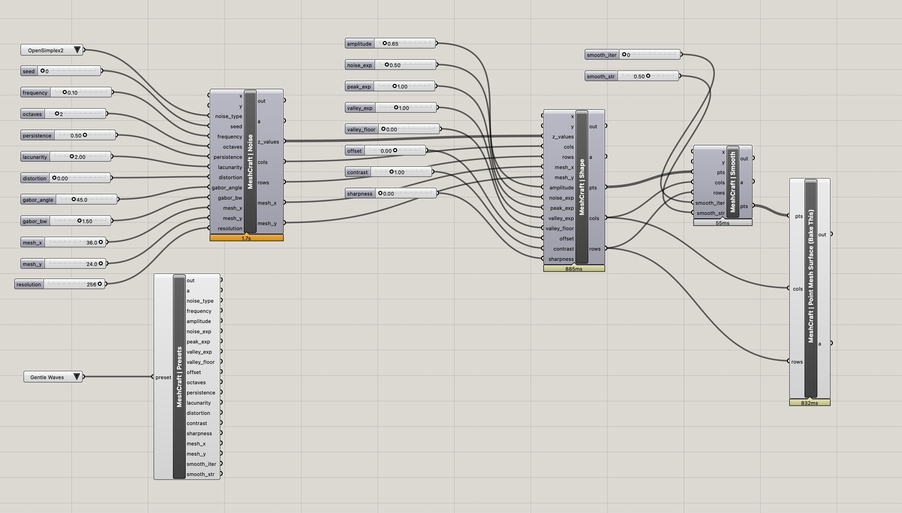

# MeshCraft

<p align="center">
  
</p>

**Browser-based 3D mesh generator and toolpath compiler for CNC machining.**

[**Try it live**](https://meshcraft.sawyerdesign.io) &nbsp;|&nbsp; Built by [Sawyer Design](https://sawyerdesign.io)

<br>

<p align="center">
  
</p>

<h3 align="center">Sponsored by <a href="https://shopbottools.com/products/desktop-max-atc/">ShopBot</a></h3>

<p align="center">
  This project is proudly sponsored by <a href="https://shopbottools.com/products/desktop-max-atc/"><strong>ShopBot Tools</strong></a>.<br>
  MESHCRAFT was built for and tested on the <a href="https://shopbottools.com/products/desktop-max-atc/">ShopBot Desktop Max ATC</a> — a production-grade CNC with automatic tool changing.
</p>

<p align="center">
  <a href="https://shopbottools.com/products/desktop-max-atc/">
    
  </a>
</p>

<p align="center">
  <a href="https://bitsbits.com">
    
  </a>
</p>

<p align="center">
  Powered by <a href="https://bitsbits.com"><strong>bitsbits.com</strong></a>
</p>

---

## What It Does

Generate 3D meshes from procedural noise or depth map images, tuned for CNC machining. Export watertight STL, OBJ, or heightmap PNG -- or compile ShopBot .sbp toolpaths directly, bypassing CAM software entirely.

### Features

- **16+ noise algorithms** — Simplex, Perlin, OpenSimplex2, Value, FBM, Ridged, Billow, Turbulence, Hybrid, Hetero, Domain Warp, Voronoi, Worley, Gabor, Wavelet, Voronoi Relief (3D cellular relief with attractor masks)
- **Depth map import**: Upload any image as a relief, or a `.mcrelief` master at full resolution
- **Drape**: Hang a silk veil over a 3D figure (the bundled Venus de Milo bust or your STL, OBJ, PLY, glTF or USDZ, scaled to fit) and carve the front view as a relief from 3 x 4 to 18 x 24 in in up to 2.6 in of material, simulated in the browser. Presets for the gathered and plain silk drapes, and controls for the pose, figure size, cloth size, resolution, thickness, bending, clearance, crown attachment, damping, attraction to the figure (overall and on the face), wind or pressure on a target area, their timing, a post-solve surface fit, solver accuracy and display smoothing
- **CNC presets** — Presets tuned for the ShopBot Desktop Max ATC (36" x 24", 6" Z)
- **STL-to-SBP toolpaths** — Two-pass roughing + finishing .sbp generation from any binary STL (CLI + web)
- **Watertight export** — Bottom face + side walls for CNC-ready meshes
- **Multiple formats** — STL (binary/ASCII), OBJ, 3DM (mesh or point cloud), heightmap PNG, SBP
- **Real-time 3D preview** — Orbit, pan, zoom with mouse or touch
- **Shareable configs** — Copy Link encodes your mesh settings into a URL

### View Modes

Solid, Wireframe, Both, Points — switch between render modes to inspect your mesh.

## Usage

Visit the live site — no install required:

**https://meshcraft.sawyerdesign.io**

### Local Development

```bash
npm install        # First time
npm run dev        # Vite dev server with HMR (http://localhost:5173)
npm run build      # TypeScript + Vite production build → dist/
npm run preview    # Preview production build locally
```

## Export Workflow

1. Adjust noise parameters or upload a depth map
2. Choose your export format (STL, OBJ, 3DM, Heightmap, or SBP)
3. For 3DM, optionally enable **Export as point cloud** to output vertices only (Rhino/Grasshopper)
4. Enable **Watertight** for CNC milling (adds bottom face + side walls)
5. Click **Export** to download

Exported STL/OBJ files are ready for CAM software like VCarve, Aspire, or Fusion 360. SBP files run directly on ShopBot CNCs -- no CAM software needed.

## Architecture

Vite + TypeScript + Three.js. Hardware-accelerated WebGL rendering with Phong shading, depth buffer, and MSAA anti-aliasing.

```text
src/
├── main.ts              # Entry point, URL state, demo preload
├── state.ts             # Typed STATE singleton, URL serialize/deserialize
├── types.ts             # Shared interfaces (Vertex3D, Triangle, MeshData)
├── noise/
│   ├── generators.ts        # 16+ noise classes + factory
│   ├── voronoi-relief.ts    # 3D Voronoi cell relief sampler (grid-aware)
│   └── presets.ts           # 18 CNC presets, 6 texture profiles
├── mesh.ts              # Mesh generation + smoothing
├── render.ts            # Three.js WebGL rendering (Phong shading, custom camera)
├── export.ts            # STL, OBJ, heightmap PNG, SBP export dispatcher
├── sbp-export.ts        # Web UI bridge: MeshCraft STATE -> SBP pipeline -> download
├── ui.ts                # Sidebar, sliders, depth map upload, SBP config panel
├── interaction.ts       # Mouse/touch orbit, pan, zoom
├── toolbar.ts           # Mode tabs, toolbar, Copy Link, format-aware controls
├── stats.ts             # Stats overlay (format-aware: triangles or SBP moves)
├── toast.ts             # Toast notifications
├── sidebar-state.ts     # Pane scroll/focus and persistent section state
├── sponsor.ts           # Explicit Sponsors pane
└── sbp/                 # STL-to-SBP pipeline (shared between web + CLI, zero Node deps)
    ├── types.ts         # ToolDef, SbpConfig, ToolpathMove, ToolpathSection
    ├── tools.ts         # Embedded ATC tool database (18 tools, 3 material profiles)
    ├── stl-parser.ts    # Binary STL -> Float32Array + bounding box
    ├── heightmap.ts     # Triangle mesh or STATE vertices -> regular Z grid
    ├── compensate.ts    # Tool compensation (separable morphological erosion)
    ├── roughing.ts      # Z-level stepdown raster
    ├── finishing.ts     # 45-deg continuous zigzag
    ├── writer.ts        # OpenSBP file builder
    ├── generate.ts      # Pipeline orchestrator
    └── worker.ts        # Web Worker for STL upload pipeline

cli/
├── stl-to-sbp.ts        # CLI entry point (Node-only: fs, process)
└── vtdb-reader.ts       # SQLite vtdb reader (better-sqlite3)
```

## STL to SBP

Generate ShopBot .sbp toolpath files directly from any binary STL -- no Vectric Aspire or other CAM software required. Two-pass pipeline: roughing (Z-level raster) + finishing (45-deg continuous zigzag with tool compensation).

### How it works

1. Parse binary STL into a triangle mesh
2. Rasterize to a heightmap (Z grid at configurable resolution, default 200 cells/inch)
3. Apply morphological erosion for tool compensation (separable 1D passes, handles tapered ball nose geometry)
4. Generate roughing toolpath: Z-level stepdown, serpentine raster, skip empty rows
5. Generate finishing toolpath: 45-deg bidirectional zigzag, continuous M3 path with entry/exit retracts
6. Write OpenSBP with full ATC support (tool changes, spindle control, feed rates)

### CLI

```bash
./stl-to-sbp.sh <input.stl> [options]

# or
npm run stl-to-sbp -- <input.stl> [options]
```

Options:

```text
-o, --output <file>          Output .sbp (default: <input>.sbp)
--vtdb <file>                Vectric tool database (.vtdb)
--roughing-tool <pattern>    Match tool by name substring
--finishing-tool <pattern>   Match tool by name substring
--roughing-atc <N>           Override ATC slot
--finishing-atc <N>          Override ATC slot
--resolution <N>             Heightmap cells/inch (default: 200)
--material-thickness <N>     Material Z in inches (default: STL Z max)
--material <profile>         general | mdf | hardwood (default: general)
--offset-x <N>               Workpiece X offset (default: 2.0)
--offset-y <N>               Workpiece Y offset (default: 2.0)
--safe-z <N>                 Safe Z height (default: 1.6)
--home-z <N>                 Home Z height (default: 2.3)
--stock-allowance <N>        Leave stock for finishing (default: 0.02)
--finish-angle <N>           Raster angle in degrees (default: 45)
--roughing-only              Skip finishing pass
--finishing-only             Skip roughing pass
--dry-run                    Print stats without writing file
```

The CLI reads Vectric `.vtdb` tool databases (SQLite) via `--vtdb` for cutting parameters. Without `--vtdb`, it uses embedded tool data covering 18 tools across 3 material profiles (General, MDF, Hardwood).

### Web

Select **SBP** as the export format in the toolbar. The SBP config panel appears in the sidebar with tool selection, material profile, and roughing/finishing toggles. Two modes:

1. **From mesh**: Exports the current MeshCraft mesh directly (instant)
2. **From STL upload**: Upload any binary STL file -- runs the full pipeline in a Web Worker to keep the UI responsive

### Tool library

18 tools from the ShopBot Desktop Max ATC rack, organized by ATC slot position:

| Slot | Tools |
|------|-------|
| 1 | 1.25" Surfacing EM |
| 2 | 1.25" 90-deg V-Bit |
| 3 | 3/8" Chipbreaker EM (default roughing) |
| 4 | 0.25" BN Spiral EM, 3/8" Radiused EM |
| 5 | 3/8" Straight BN, 1/4" Spiral BN |
| 6 | 1/8" Spiral Upcut, 1/4" O-Flute EM |
| 7 | TBN R1/32-S1/4, TBN R1/16-S1/4 (default finishing) |

Each tool has cutting data for all three material profiles (General, MDF, Hardwood) with feed rates, plunge rates, RPM, stepdown, and stepover.

### Known limitations

- **Heightfield meshes only** -- one Z per XY cell. No overhangs or undercuts.
- **Raster roughing** -- ~20-40% more air-cutting than Aspire's contour spiral. Same material removal.
- **Uniform point density** -- 0.005" between M3 points (vs Aspire's adaptive 0.012-0.024"). Larger files, same stepover, negligible cycle time difference.
- **Web SBP is gated** -- button hidden in production until physical carve validation passes.

---

## Grasshopper / Rhino 7

The Python components and builder stay in this Git repository. The native definitions live in Sawyer Design's local library:

```text
/Users/sawyer/Code/sawyer-design/rhino-aspire-grasshopper/rhino/grasshopper/meshcraft-repo/
  mesh-maker.gh
  meshcraft_builder.gh
  README.md
```

These preserved definitions belong to the repository branch. The separate `mesh-maker-dllwip.gh` in the parent library uses the compiled DLL and remains a distinct work in progress. Do not combine them by filename. This repository no longer carries a duplicate DLL or a Rhino host model.

<p align="center">
  
</p>

<p align="center">
  
</p>

### Current source and regeneration

[Component scripts](grasshopper/components/) are the canonical GhPython source. The [builder](grasshopper/builder/meshcraft_builder.py) embeds the Noise, Shape, Smooth and Presets components. Its generated canvas wires Noise through Shape to Smooth and leaves preset outputs unwired. It produces points; add the mesh/surface construction appropriate to the consuming definition. The current builder uses Python components and does not load `MeshCraftNoise.dll`.

1. Open Rhino 7 and Grasshopper.
2. Paste the complete builder script into a GhPython component with `run` and `save_path` inputs and an `a` output.
3. Set `save_path` to the library's `meshcraft-repo/meshcraft_builder.gh` path above and set `run` true.
4. Inspect the log, open the saved definition and wire a preset's outputs to the matching component inputs.
5. Confirm one preset generates before using the result in a project. Preserve known-good native artifacts before deliberately replacing them.

The saved `.gh` files contain embedded scripts. Updating Python source does not update an existing definition. Run `npm run test:gh-parity` from this repository to compare the builder's Noise, Presets, Shape and Smooth scripts with their canonical sources and its preset values with the web table. It also compares the physical Gaussian kernels using a Python host stub. These checks do not execute Rhino or certify the native Shape component against the web stock/backing model. Input changes also require a native Rhino 7 regeneration and reopen check.

The migration preserved the historical definitions and previews unchanged. Slice 3 deliberately regenerates the builder definition, preserving its historical preimage and recording the current source and native checks in the library regeneration receipt. The separate historical `mesh-maker.gh` stays unchanged. Native Shape output does not implement the web stock/backing contract. Native hosts and baked project geometry belong to the consuming Sawyer Design project. Nick's integrated Rhino master remains owner-controlled.

The DLL branch's `MeshCraftNoise.cs` implementation is retained separately in `/Users/sawyer/Code/sawyer-design/rhino-aspire-grasshopper/rhino/grasshopper/ghpy/`, with its compiled library in the parent `grasshopper/` folder. Read that branch's instructions before changing it. No DLL installation is required by the current repository builder.

## License

MIT
